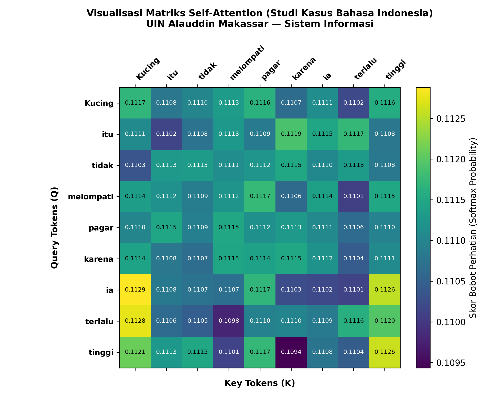

# Tugas Analisis 1 — Self-Attention

Simulasi Scaled Dot-Product Attention untuk kalimat:
> Kucing itu tidak melompati pagar karena ia terlalu tinggi

## Menjalankan di Windows

Install Python 3.10 atau lebih baru, buka terminal di folder proyek, lalu:

```powershell
py -m pip install -r requirements.txt
py AI_analisis1.py
```

Di Linux/macOS gunakan `python3 -m pip install -r requirements.txt` dan `python3 AI_analisis1.py`.

## Output

- `output/attention_heatmap_pekan_05_indonesia.png`: heatmap 9 × 9.
- `output/attention_weights.csv`: bobot setiap pasangan query dan key.
- `output/ringkasan.json`: ringkasan bobot dan parameter.



Baris adalah query (kata yang memperhatikan), kolom adalah key (kata yang diperhatikan).
Jumlah bobot setiap baris adalah 1. Angka ditampilkan dengan empat desimal agar perbedaan kecil terlihat.
Rentang warna otomatis mengikuti data, sehingga perbedaan warna yang besar belum tentu berarti selisih angka yang besar.

## Batasan dan perbaikan

Kode mempertahankan kalimat, seed 42, dimensi 16, dan modifikasi key pada skrip awal.
Perbaikan: seed di dalam fungsi, backend tanpa jendela, ekspor CSV/JSON,
penempatan hasil yang konsisten, dan label heatmap lebih teliti.
Bobot mendekati 1/9; simulasi belum dilatih dan tidak membuktikan pemahaman makna
atau keberhasilan resolusi kata ganti. Key untuk Kucing, pagar, dan tinggi dimodifikasi manual.
Tidak ada klaim bobot 0.58 atau 0.24 karena angka itu tidak dihasilkan skrip.

## Perhitungan manual

Untuk Q = [[1,2],[0,1],[2,1]] dan K = [[1,0],[2,1],[1,1]],
QK^T = [[1,4,3],[0,1,1],[2,5,3]]. Bagi dengan sqrt(2),
lalu terapkan softmax pada setiap baris. Eksperimen 9 token terpisah dari contoh manual ini.

## Referensi

- Vaswani et al. (2017), Attention Is All You Need: https://arxiv.org/abs/1706.03762
- Devlin et al. (2019), BERT: https://aclanthology.org/N19-1423/
